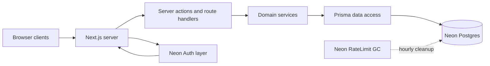
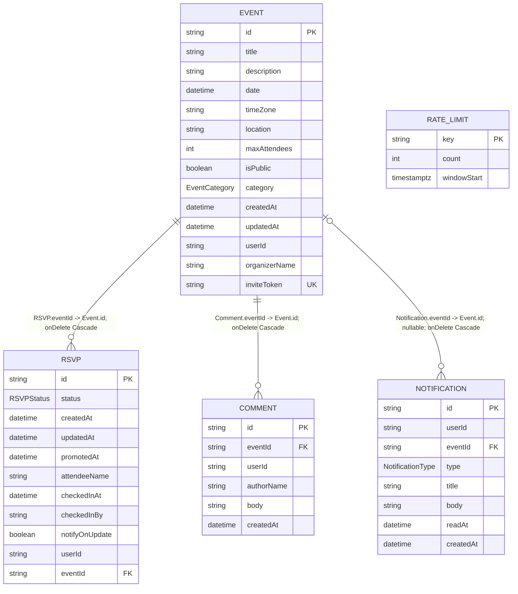

# Event Manager

Event Manager is a full-stack Next.js application for creating, discovering,
managing, and attending events. It supports public and private events, RSVP
waitlists, comments, in-app notifications, organizer check-in, invite links,
calendar export, attendee CSV export, and timezone-aware scheduling. The
application uses Neon PostgreSQL for durable data, Prisma for data access, and
Neon Auth for identity.

## Contents

- [Overview](#overview)
- [Features](#features)
- [Architecture](#architecture)
- [Functional Requirements](#functional-requirements)
- [Non-Functional Requirements](#non-functional-requirements)
- [Technology Stack](#technology-stack)
- [Getting Started](#getting-started)
- [Configuration](#configuration)
- [Database and Migrations](#database-and-migrations)
- [Scheduled Jobs](#scheduled-jobs)
- [Domain Model](#domain-model)
- [HTTP and Application Surface](#http-and-application-surface)
- [Security](#security)
- [Runtime Behavior](#runtime-behavior)
- [Testing](#testing)
- [Deployment](#deployment)
- [Project Structure](#project-structure)
- [License](#license)

## Overview

Event Manager is designed around organizer and attendee workflows:

- Organizers create events, manage visibility, monitor RSVPs and waitlists,
  check attendees in, manage private invites, and send event updates.
- Attendees discover upcoming public events, RSVP, join waitlists, comment, and
  manage their saved events and notifications.
- The public browse experience supports search, category filtering, time
  windows, sorting, organizer filtering, and pagination.
- Private events remain accessible only to the organizer and RSVP holders
  after invite acceptance.
- Event times are authored with timezone information rather than relying only on
  the server clock.

## Features

### Event discovery and browsing

- Upcoming public event grid with 12 events per page.
- Text search, category filter, time window filters (`today`, `week`, `month`),
  sort by date, newest, or popular.
- Organizer filtering and pagination.
- Category count summary.
- Event detail pages for public and permitted private events.
- Empty state, loading behavior, and not-found handling.

### Event lifecycle

- Create events with required future dates.
- Edit event metadata, visibility, capacity, date, time zone, location, and
  category.
- Delete events.
- Event organizer ownership is enforced server-side.
- Capacity cannot be reduced below the current number of `GOING` attendees.
- Increasing capacity promotes waitlisted attendees in FIFO order.
- Past events cannot receive new RSVPs or comments.

### RSVP, waitlist, and notifications

- RSVP statuses: `GOING`, `MAYBE`, `NOT_GOING`, and `WAITLISTED`.
- Waitlist assignment when an event is at capacity.
- Automatic promotion of waitlisted attendees when capacity increases.
- “You got in!” promotion banner on the wishlist page.
- Opt-in update notifications per RSVP.
- Best-effort fan-out that does not roll back the originating write.

### Organizer tools

- Organizer dashboard for upcoming and past events.
- Stats and filtering on `my-events`.
- Attendee roster and CSV export.
- Per-attendee check-in and undo.
- Invite link generation, revocation, and regeneration for private events.
- Event update and cancellation fan-out to opted-in holders.

### Comments, notifications, and engagement

- Threaded discussion support with author and organizer delete permissions.
- Comment body is limited to 1000 characters.
- In-app notification center with unread counts.
- Mark one or all notifications as read.
- Upcoming-events widget with lazy reminder generation.

### Scheduling, calendar, and timezone support

- IANA timezone support for event wall clocks.
- Default application timezone fallback via `APP_TIME_ZONE`.
- ICS calendar export with fixed two-hour event duration.
- Google Calendar link generation.
- Browse day boundaries are calculated in the configured application time zone.

### Rate limiting and data export

- Per-user fixed-window rate limits for write and fan-out operations.
- Durable rate-limit counters in PostgreSQL.
- Hourly Neon Function garbage collection for stale counters.
- Attendee CSV export with 500-row streaming pages and spreadsheet formula
  injection protection.

## Architecture

The primary interactive architecture diagram is stored as a standalone HTML
artifact:

- [Event Manager Runtime Architecture](./event-manager.architecture.html)

Open that file in a browser to use pan/zoom, search, focus, relationship
tracing, theme switching, and exports.

### Component overview

Core runtime components:

- Browser clients: React UI rendered through React Server Components and client
  components.
- Next.js server: App Router runtime and server rendering.
- Auth layer: Neon Auth SDK and proxy integration.
- Server actions and route handlers: mutations and API endpoints.
- Domain services: events, RSVP, invitations, comments, notifications, and
  check-in.
- Rate limiter: per-user fixed-window budgets and best-effort sweeps.
- Data access: Prisma client with the Neon adapter.
- Neon Postgres: managed PostgreSQL database.
- RateLimit GC: Neon Function and scheduled trigger for counter cleanup.

### Mermaid architecture overview



### Primary request / data path

1. Browser clients send requests to the Next.js server.
2. Auth middleware verifies and manages the session.
3. Server actions and route handlers validate input.
4. Domain services apply business rules, concurrency controls, and notification
   rules.
5. Data access queries Neon PostgreSQL through Prisma.
6. Responses revalidate affected paths and return to the browser.

### Trust boundaries

- Browser client boundary: untrusted user-facing code and network traffic.
- Application server boundary: Next.js server, auth integration, server
  actions, domain services, rate limiter, and data access.
- Neon-managed services boundary: PostgreSQL and the scheduled cleanup function,
  plus the externally managed Neon Auth identity service.

### External dependencies

- Neon PostgreSQL
- Neon Auth
- Neon Functions and function triggers
- React and Next.js runtime
- Prisma Client and Prisma Neon adapter
- Node.js runtime
- Browser clients using the generated UI

## Functional Requirements

- FR-01 Authentication and session management is handled through Neon Auth; protected
  routes require authenticated users.
- FR-02 Users can create, edit, and delete their own events.
- FR-03 Public event discovery supports search, category, time window, sort,
  organizer filtering, and pagination.
- FR-04 Event detail access respects public and private visibility rules.
- FR-05 Attendees can RSVP as `GOING`, `MAYBE`, or `NOT_GOING`; full events place
  attendees on a waitlist.
- FR-06 Capacity cannot fall below current `GOING` attendance, and capacity
  increases promote eligible waitlisted attendees.
- FR-07 Organizers can view rosters, export attendees, and check attendees in and
  out.
- FR-08 Users can add comments and authors or event organizers can delete them.
- FR-09 Notification fan-out supports promotion, event update, event cancellation,
  comment, and reminder types.
- FR-10 Private events use reusable, revocable, and regenerable invite tokens.
- FR-11 Calendar export supports ICS generation and Google Calendar links.
- FR-12 CSV attendee export streams rows and neutralizes spreadsheet formula
  injection.
- FR-13 The notifications page lazily generates reminders for events occurring
  within 48 hours.
- FR-14 Event date input, parsing, validation, and display are timezone-aware.
- FR-15 Write-heavy operations use per-user rate limits.

## Non-Functional Requirements

- NFR-01 Static quality is gated through TypeScript and scoped ESLint.
- NFR-02 Request rendering uses cache and query patterns that avoid repeated
  database work.
- NFR-03 RSVP capacity mutations are serialized with PostgreSQL advisory locks.
- NFR-04 Notification fan-out is best effort and does not roll back parent writes.
- NFR-05 Requests receive security, transport, framing, referrer, and content
  type headers.
- NFR-06 User-generated content is rendered with React escaping; SQL access is
  parameterized through Prisma.
- NFR-07 Interactive views are covered by accessibility testing in E2E.
- NFR-08 Event wall-clock behavior is controlled through IANA timezone handling
  and configuration.
- NFR-09 Schema changes are migration-only and protected by drift checks.
- NFR-10 Required environment values are validated at runtime.
- NFR-11 Server-side failures are correlated through an instrumentation error
  hook.
- NFR-12 Database tests run against isolated disposable Neon branches with safety
  guards.

## Technology Stack

| Area | Technology |
| --- | --- |
| Framework | Next.js App Router 16 |
| UI | React 19, Tailwind CSS 4 |
| Identity | Neon Auth |
| Database | Neon PostgreSQL |
| ORM | Prisma 7 with Neon adapter |
| Language | TypeScript |
| Testing | Vitest, Testing Library, Playwright, axe-core |
| Styling | Tailwind CSS 4 |
| Runtime jobs | Neon Function Trigger |
| Data validation | Server-side form validation |

## Getting Started

### Prerequisites

- Node.js 20 or newer
- npm
- Neon account and project credentials

### Installation

```bash
npm install
cp .env.example .env
```

### Environment variables

| Variable | Required | Purpose |
| --- | --- | --- |
| `DATABASE_URL` | Yes | Pooled PostgreSQL connection used by app runtime. |
| `DATABASE_URL_UNPOOLED` | Yes | Direct connection used by Prisma CLI and introspection. |
| `NEON_AUTH_BASE_URL` | Yes | Neon Auth endpoint used by server and client auth. |
| `NEON_AUTH_COOKIE_SECRET` | Yes | Secret used to sign and encrypt auth cookies. |
| `APP_TIME_ZONE` | No | Fallback IANA timezone for event wall clocks and browse boundaries; defaults to `UTC`. |

Set deploy environment values separately because `.env` is gitignored.

### Database setup

```bash
npx prisma migrate deploy
```

For local development, use:

```bash
npx prisma migrate dev
```

Do not run `prisma db push` against this database. Constraints and migration-only
behavior live in migration SQL and can be dropped by push.

### Run the application

```bash
npm run dev
```

Open [http://localhost:3000](http://localhost:3000).

Production build:

```bash
npm run build
npm run start
```

## Configuration

- `APP_TIME_ZONE` controls fallback event timezone parsing and browse day
  boundaries.
- `NODE_ENV` affects caching, cookie handling, and Prisma client caching.
- Security headers are configured for all routes and include `nosniff`, strict
  referrer policy, `X-Frame-Options: DENY`, HSTS, a permissions policy, and a
  report-only Content Security Policy.
- Next.js enables App Router cache components, partial prefetching, and the
  React compiler.
- Managed Auth session cookies are handled by Neon Auth, with render-safe cookie
  refresh in server components.

## Database and Migrations

Application domain tables:

| Table | Purpose |
| --- | --- |
| `Event` | Event identity, metadata, visibility, capacity, timezone, and invite token. |
| `RSVP` | Attendee response status, waitlist promotions, attendee check-in, and notification opt-out. |
| `Comment` | Event discussion messages. |
| `Notification` | User notifications for event changes, cancellations, promotions, comments, and reminders. |
| `RateLimit` | Fixed-window per-scope counters. |

ERD source:

- [Database ERD Markdown](./archify/erd.md)



Notes:

- `Event.inviteToken` is unique when present.
- `RSVP(userId, eventId)` is unique.
- `RateLimit.key` is the primary key.
- `Event.maxAttendees` is either `NULL` or greater than zero at the database
  level.
- `Comment.body` is limited to 1000 characters at the database level.
- Several indexes exist for user, event, status, creation, and read-state queries.
- Neon Auth user IDs are plain strings, not foreign keys, because identity is
  managed externally.
- Run `npm run db:test:drift` to detect schema drift.

## Scheduled Jobs

The `RateLimit` table is garbage collected hourly by a Neon Function Trigger
declared in `neon.ts`.

- Function slug: `ratelimitgc`
- Trigger name: `rate-limit-gc-hourly`
- Cron: `17 * * * *` UTC
- Handler: `functions/rate-limit-cleanup.ts`

Manual cleanup:

```bash
npx tsx scripts/rate-limit-cleanup.ts          # dry run
npx tsx scripts/rate-limit-cleanup.ts --apply  # delete stale rows
```

The in-process sweep is best effort only; the scheduled job is authoritative.

## Domain Model

Primary entities:

- `Event`: event identity and scheduling state.
- `RSVP`: attendee response, waitlist state, promotion state, opt-out, and
  check-in.
- `Comment`: event discussion message.
- `Notification`: in-app user notification.
- `RateLimit`: throttling counter.

Cardinality:

- One `Event` can have zero or more `RSVP` records.
- One `Event` can have zero or more `Comment` records.
- One `Event` can have zero or more `Notification` records.
- A `Notification` can refer to zero or one `Event`.
- Attendee identity is managed by Neon Auth and is not represented as a database
  foreign key in this application schema.

## HTTP and Application Surface

Primary API routes:

| Route | Purpose |
| --- | --- |
| `/api/auth/[...path]` | Neon Auth proxy |
| `/api/events/[id]/calendar` | ICS calendar export |
| `/api/events/[id]/attendees` | Attendee CSV export |

Major application routes:

| Route | Purpose |
| --- | --- |
| `/` | Marketing and redirect entry point |
| `/auth/sign-in`, `/auth/sign-up` | Authentication pages |
| `/events` | Public event discovery |
| `/events/new` | Event creation |
| `/events/[id]` | Event detail |
| `/events/[id]/edit` | Event editing and deletion |
| `/invite/[token]` | Private invite acceptance |
| `/my-events` | Organizer dashboard |
| `/wishlist` | Saved promotions and waitlists |
| `/notifications` | Notification center |
| `/account` | Account identity details |

Server actions handle event creation, edits, comments, invitations, RSVPs,
notifications, and check-in workflows.

## Security

- Authentication is provided by Neon Auth through a proxied route.
- Authenticated routes are protected by middleware.
- Server actions enforce organizer ownership and visibility rules.
- Check-in, attendee export, roster, and invite management are organizer-only.
- Private events return not-found style responses to unauthorized users where
  appropriate.
- Comments can be deleted by their author or by the event organizer.
- CSV output neutralizes spreadsheet formula injection.
- Database access uses parameterized Prisma queries.
- Security headers include:
  - `X-Content-Type-Options: nosniff`
  - `Referrer-Policy: strict-origin-when-cross-origin`
  - `X-Frame-Options: DENY`
  - `Strict-Transport-Security: max-age=63072000; includeSubDomains`
  - `Permissions-Policy: camera=(), microphone=(), geolocation=()`
- Content Security Policy starts in report-only mode.

## Runtime Behavior

- Next.js App Router runs in Node.js.
- Dynamic request boundaries are used for session-sensitive pages.
- Server Components and route handlers access the database at request time.
- Prisma uses the Neon adapter over the pooled connection URL.
- Time-sensitive event counts use RepeatableRead snapshots.
- RSVP operations use PostgreSQL advisory transaction locks.
- React `cache` deduplicates event and count reads during a render.
- Server error correlation is handled by instrumentation.
- Rate-limit modules retain process-local state and use the durable table as the
  long-lived counter source.

## Testing

Testing documentation is maintained in `TESTING.md`; this section summarizes the
available layers and commands.

Commands:

| Command | Purpose |
| --- | --- |
| `npm run typecheck` | TypeScript check |
| `npm run lint` | Repository lint |
| `npm run verify` | Typecheck, scoped lint, build |
| `npm test` | Unit and component tests |
| `npm run test:db` | Database integration tests |
| `npm run test:http` | HTTP contract tests |
| `npm run test:perf` | Performance tests |
| `npm run test:e2e` | Playwright E2E suite |
| `npm run test:e2e:smoke` | Smoke tests |
| `npm run test:all` | Full test sequence |

Test layers:

- Unit tests cover utilities, validation, timezone logic, search, and auth cookie
  handling.
- Component tests exercise UI components with Testing Library.
- Database integration tests use an ephemeral Neon branch, factories, concurrency
  checks, idempotency checks, and fault injection.
- HTTP contract tests launch the built application and verify headers, auth,
  calendar, and CSV behavior.
- E2E tests use desktop Chromium and mobile emulation with seeded roles.
- Performance tests cover browse, RSVP, waitlist, and wishlist-queue flows.
- Hygiene tests prevent non-deterministic test patterns such as `waitForTimeout`
  and skipped test guards.
- Coverage is collected with V8 and configured thresholds.
- `npm run db:test:drift` checks migration/schema consistency.

Ephemeral database tests require setup from `TESTING.md`. Playwright global setup
seeds data and global teardown verifies that tables are empty after the run.

## Deployment

- The application is a Next.js production deployment target.
- Configure all environment variables in the deployment environment.
- Run database migrations before serving production traffic.
- Deploy the Neon function and trigger that perform hourly RateLimit cleanup.
- Use the direct `DATABASE_URL_UNPOOLED` connection only for migration and
  introspection operations.
- Set `APP_TIME_ZONE` explicitly in the deploy environment because `.env` is
  gitignored.

## Project Structure

```text
event-manager/
├── archify/              # Reference diagrams
├── functions/            # Neon runtime functions
├── prisma/               # Schema and migrations
├── scripts/              # Database and test automation
├── src/
│   ├── app/              # Routes, pages, layouts, and server actions
│   ├── components/       # Shared UI components
│   ├── db.ts             # Prisma client initialization
│   ├── lib/              # Domain and integration logic
│   └── proxy.ts          # Auth middleware
├── tests/
│   ├── components/       # Component tests
│   ├── db/               # Database integration tests
│   ├── e2e/              # Playwright tests
│   ├── http/             # HTTP contract tests
│   ├── perf/             # Performance tests
│   └── unit/             # Unit tests
├── TESTING.md
├── package.json
└── README.md
```

## License

All rights reserved.
