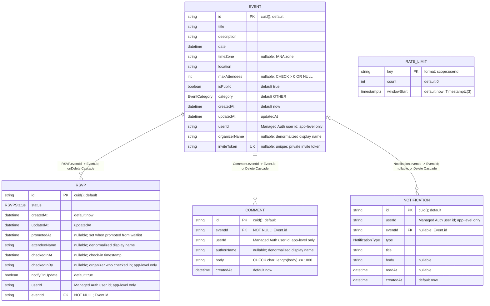

# Event Manager database ERD

Source: `prisma/schema.prisma`

Identity is managed by Neon Auth in the separate `neon_auth` schema. Fields
such as `userId`, `organizerName`, `attendeeName`, `checkedInBy`, and `authorName`
are application-level references and denormalized display values, not PostgreSQL
foreign keys. Physical indexes are listed as comments for fields/tables below.

## Relationship notes

- `EVENT ||--o{ RSVP`: one Event may have zero or more RSVPs; every RSVP belongs to
  exactly one Event.
- `EVENT ||--o{ COMMENT`: one Event may have zero or more Comments; every Comment
  belongs to exactly one Event.
- `EVENT |o--o{ NOTIFICATION`: one Event may have zero or more Notifications; a
  Notification may belong to zero or one Event because `eventId` is nullable.

## Constraints summarized outside the table headers

- `Event.inviteToken` is unique when present.
- `RSVP(userId, eventId)` is unique.
- `RateLimit.key` is the primary key.
- `Event.maxAttendees` is either NULL or greater than 0 at the database level.
- `Comment.body` is limited to 1000 characters at the database level.
- Neon Auth user identifiers are not enforced by database foreign keys.
